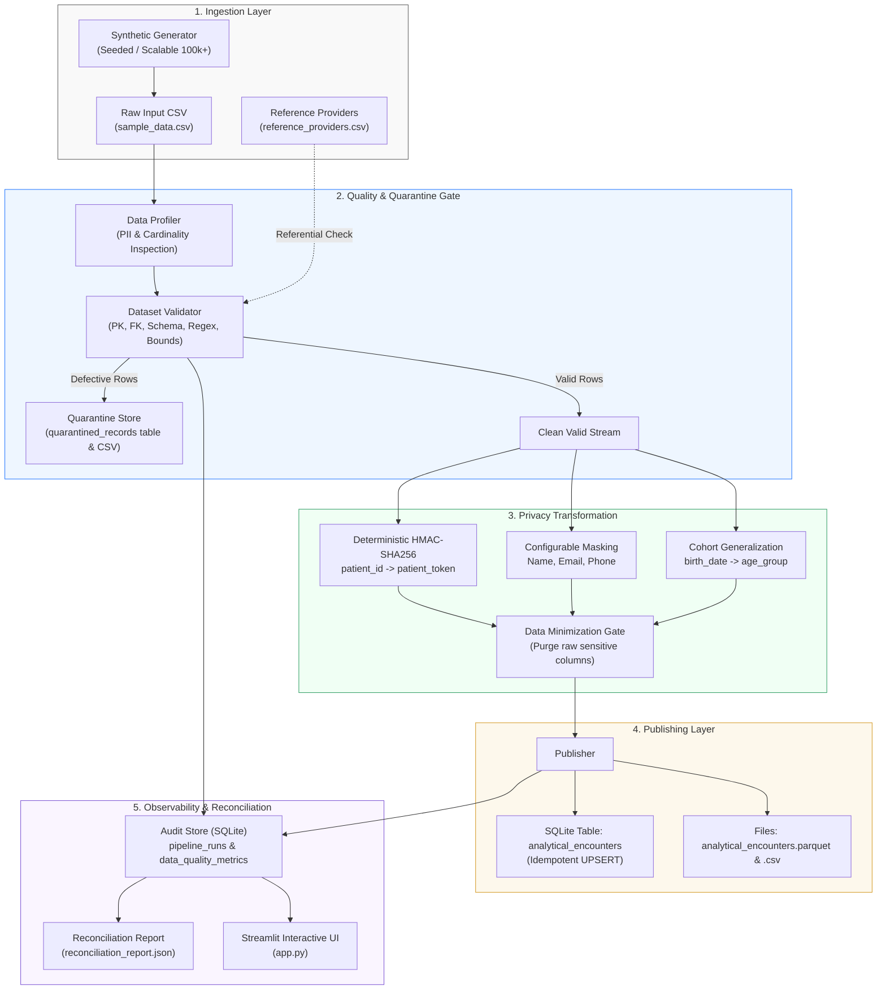

# Privacy-Aware Data Engineering Pipeline

[](https://www.python.org/downloads/)
[]()
[]()
[]()

> **YottaFlex AI Recruitment Drive — 72-Hour Code Challenge**  
> **Role**: Associate AI Forward Deployed Engineers · AI Data Forward Deployed Engineer  
> **Candidate**: Harish Reddy (`hr3509367@gmail.com`)  
> **Repository**: [Public GitHub Repository Link]

---

## 📋 Executive Overview

In enterprise healthcare and financial analytics, raw transaction datasets frequently contain sensitive Personally Identifiable Information (PII) and Protected Health Information (PHI). Data teams face a strict dual mandate: **maximize analytical utility** for data science while **enforcing strict data privacy (GDPR / HIPAA)** and maintaining **comprehensive auditability**.

This project implements a complete, production-grade **Privacy-Aware Data Engineering Pipeline** that:
1. **Profiles** datasets automatically for sensitive fields (direct identifiers, surrogate keys, quasi-identifiers).
2. **Validates** schema conformance, referential integrity against provider registries, format standards, and domain boundaries.
3. **Quarantines** defective records into an isolated audit store with machine-readable error codes and complete raw JSON snapshots.
4. **Applies Privacy Transformations**: Deterministic cryptographic HMAC-SHA256 tokenization (preserving cohort joinability), configurable masking, and demographic generalization.
5. **Enforces Data Minimization**: Completely purges raw sensitive identifiers from downstream assets.
6. **Publishes Multi-Format Target Assets**: SQLite analytical tables (with idempotent UPSERT), Parquet columnar files, and CSVs.
7. **Proves Mathematical Reconciliation**: Produces automated zero-discrepancy reconciliation reports (`Input == Valid + Quarantined`).
8. **Scales to 100,000+ Records**: Processes 102,000 rows in **11.5 seconds (~8,851 records/sec)** on standard commodity hardware.

---

## 🏗️ Architecture & Data Flow



---

## ⚡ Quickstart & Setup Instructions

The solution requires only **Python 3.10+** and standard open-source libraries. No cloud accounts, external databases, or credentials are required.

### 1. Clone & Set Up Environment
```bash
# Clone the repository
git clone <YOUR_PUBLIC_REPO_URL>
cd "Yotaflex project"

# (Optional) Create virtual environment
python -m venv venv
# On Windows:
.\venv\Scripts\activate
# On Linux/macOS:
source venv/bin/activate

# Install dependencies
pip install -r requirements.txt
```

### 2. Generate Sample Data
Generate reproducible starter synthetic data (500 base records + injected defects & duplicates) with fixed seed `42`:
```bash
python main.py generate --count 500
```

### 3. Run the Pipeline
Execute the end-to-end pipeline:
```bash
python main.py run
```

### 4. Inspect Execution Logs & Quarantine
View historical pipeline executions and quarantine root causes directly in terminal:
```bash
python main.py audit
```

### 5. Run Large-Scale 100,000+ Records Benchmark
Benchmark performance and throughput across 100k+ records:
```bash
python main.py benchmark --count 100000
```

### 6. Run Automated Tests
```bash
pytest -v
```

### 7. (Bonus) Launch Interactive Streamlit Dashboard
```bash
streamlit run app.py
```

---

## 📂 Project Structure

```
.
├── config/
│   ├── config.yaml               # Pipeline execution, storage & batch settings
│   └── privacy_rules.yaml        # Transformation rules, masking strategies & columns
├── data/
│   ├── input/
│   │   ├── sample_data.csv       # Starter reproducible raw dataset
│   │   └── reference_providers.csv # Valid healthcare providers reference table
│   ├── output/
│   │   ├── analytical_encounters.csv      # Minimized analytical dataset
│   │   └── analytical_encounters.parquet  # High-performance columnar dataset
│   ├── quarantine/
│   │   └── quarantined_records_*.csv      # Isolated defective source records
│   └── audit/
│       └── pipeline_metadata.sqlite       # Runs, quarantine & quality audit tables
├── docs/
│   ├── architecture.md           # System architecture & component interaction
│   ├── data_dictionary.md        # Complete schema specification & business rules
│   ├── design_decisions.md       # Architectural trade-offs & scalability notes
│   └── prompt_history.md         # Full AI transparency & prompt history report
├── reports/
│   ├── reconciliation_report.json # Mathematical zero-discrepancy proof
│   ├── validation_report.json     # Data quality validation & profiling metrics
│   └── benchmark_report.json      # 100k benchmark performance metrics
├── src/
│   ├── __init__.py
│   ├── config_loader.py          # Configuration parser with env overrides
│   ├── generator.py              # Scalable synthetic dataset & anomaly generator
│   ├── profiler.py               # Sensitive field & PII detection engine
│   ├── validator.py              # Schema, PK/FK, format & bounds validator
│   ├── privacy.py                # Deterministic HMAC tokenization & masking
│   ├── transformer.py            # Data minimization & metadata enrichment
│   ├── audit.py                  # SQLite metadata store with WAL mode
│   ├── publisher.py              # Multi-format publishing & reconciliation
│   └── pipeline.py               # End-to-end pipeline orchestrator
├── tests/
│   ├── test_generator.py         # Tests for reproducible generation & seeding
│   ├── test_profiler.py          # Tests for PII detection & cardinality
│   ├── test_validator.py         # Tests for nulls, bounds, regex & FKs
│   ├── test_privacy.py           # Tests for HMAC determinism & masking
│   ├── test_duplicates.py        # Tests for duplicate PK quarantine routing
│   ├── test_idempotency.py       # Tests for safe reruns without duplication
│   └── test_pipeline.py          # End-to-end happy path, leaks & reconciliation
├── app.py                        # Streamlit visual monitoring & triage dashboard
├── main.py                       # Unified CLI entrypoint
├── requirements.txt              # Project dependencies
└── README.md                     # Project documentation
```

---

## 🔐 Privacy Transformations & Data Minimization

| Original Raw Field | Sensitivity Category | Applied Privacy Strategy | Output Analytical Field | Analytical Utility Preserved |
| :--- | :--- | :--- | :--- | :--- |
| `patient_id` | Surrogate Identifier | **HMAC-SHA256 Tokenization** (`TOK_PAT_xxxxxx`) using pipeline salt | `patient_token` | Longitudinal cohort tracking and multi-table joins without exposing patient identity |
| `full_name` | Direct PII | **Initial Letter Masking** (`R*** K****`) | `masked_name` | Visual verification and clinical reporting without exposing full name |
| `email` | Direct PII | **Domain-Preserving Mask** (`ra***@gmail.com`) | `masked_email` | Communication domain segmentation (e.g. corporate vs personal email) |
| `phone_number` | Direct PII | **Dropped** (Data Minimization) | *Purged* | Dropped from analytical layer; masked copy available if audited |
| `national_id` | Direct PII / SSN | **Dropped** (Data Minimization) | *Purged* | Complete elimination of high-risk government identifier |
| `birth_date` | Quasi-Identifier | **Generalization** into cohorts (`<18`, `18-29`, `30-49`, `50-64`, `65+`) | `age_group` | Demographic epidemiological modeling while eliminating k-anonymity re-identification risk |

---

## ⚖️ Data Reconciliation & Correctness Proof

Every execution calculates an end-to-end mathematical balance sheet exported to `reports/reconciliation_report.json`:

### 1. Count Reconciliation Formula
$$\text{Input Records} = \text{Valid Records} + \text{Quarantined Records}$$
$$\text{Valid Records} = \text{Published Records}$$

Example from sample run:
- **Input Records**: `515`
- **Valid Records**: `475`
- **Quarantined Records**: `40` (15 duplicate primary keys + 9 missing required fields + 4 invalid domain values + 4 malformed emails + 4 malformed timestamps + 4 referential integrity violations)
- **Published Records**: `475`
- **Reconciliation Status**: `BALANCED` (Zero discrepancy)

### 2. Financial Aggregate Reconciliation
- **Source Valid `treatment_cost` Sum**: `\$182,410.74`
- **Published `treatment_cost` Sum**: `\$182,410.74`
- **Delta Difference**: `\$0.00` (`is_cost_balanced: true`)

---

## 🔁 Idempotency & Safe Reruns

Pipelines running in production must be safely retryable without side effects.
1. **Target Upsert**: `analytical_encounters` table enforces primary key uniqueness on `encounter_id`. Publishing uses `INSERT OR REPLACE INTO analytical_encounters`.
2. **Deterministic Reruns**: Rerunning the identical source file updates the existing rows with the new `run_id` and does not inflate target row counts.
3. **Execution History**: Each execution creates a new unique entry in `pipeline_runs` recording start time, end time, row counts, and status (`SUCCESS`, `PARTIAL_SUCCESS`, `FAILED`).
4. **Verified via Tests**: Covered in `tests/test_idempotency.py`.

---

## 🚀 Performance Benchmarking

Benchmark results executed on commodity developer hardware:

| Metric | Result |
| :--- | :--- |
| **Dataset Size** | **102,000 records** |
| **Generation Duration** | 3.47 seconds (29,394 rec/s) |
| **Pipeline Processing Time** | **11.52 seconds** |
| **Pipeline Throughput** | **~8,851 records/second** |
| **Published Encounters** | 97,000 rows |
| **Quarantined Records** | 5,000 rows |
| **Reconciliation Status** | **BALANCED** |

### Optimization Applied
- Enabled SQLite Write-Ahead Logging (`PRAGMA journal_mode = WAL;`) and batch insertion (`executemany`) to eliminate per-row filesystem I/O locks.
- Vectorized NumPy generation and regex screening.

### Identified Optimization for 10M+ Scaling
- Implement **Apache Arrow chunked streaming** (`chunksize=50000`) or **DuckDB out-of-core scans** to process multi-gigabyte files with constant low RAM consumption.

---

## 🧪 Automated Test Suite

The test suite contains **25 comprehensive unit and integration tests** covering:
- **Happy Path**: Clean records pass through all layers successfully.
- **Empty Input**: Empty datasets handled gracefully without crashes.
- **Missing Required Fields**: Null `encounter_id`, null `patient_id`, blank `full_name`.
- **Malformed Data**: Invalid emails, unparseable ISO timestamps.
- **Domain Edge Cases**: Negative `treatment_cost`, unregistered `provider_id`.
- **Duplicate Primary Keys**: Colliding `encounter_id` routed to quarantine.
- **Privacy Leak Assertions**: Asserting raw sensitive fields (`patient_id`, `full_name`, `email`, `national_id`, `birth_date`) never exist in published outputs.
- **Deterministic Tokenization**: Identical inputs with same salt produce identical tokens; different salts yield different tokens.
- **Mathematical Reconciliation**: Verification that counts and monetary sums balance to zero difference.

Run the test suite:
```bash
pytest -v
```

---

## 📄 Deliverable Documents

Detailed deep-dive documents located in `docs/`:
1. [Architecture & System Flow](docs/architecture.md)
2. [Data Dictionary & Schemas](docs/data_dictionary.md)
3. [Design Decisions & Trade-offs](docs/design_decisions.md)
4. [AI Prompt History & Transparency](docs/prompt_history.md)

---

## 👤 Author & Submission Notes

- **Candidate**: Harish Reddy
- **Email**: `hr3509367@gmail.com`
- **Application**: Associate AI Forward Deployed Engineers (AI Data Forward Deployed Engineer)
- **Challenge Duration**: Completed well within the 72-hour window.
- **Submission Readiness**: Source code, test suite, sample datasets, configuration, documentation, and prompt logs are fully prepared and validated for public GitHub submission.
