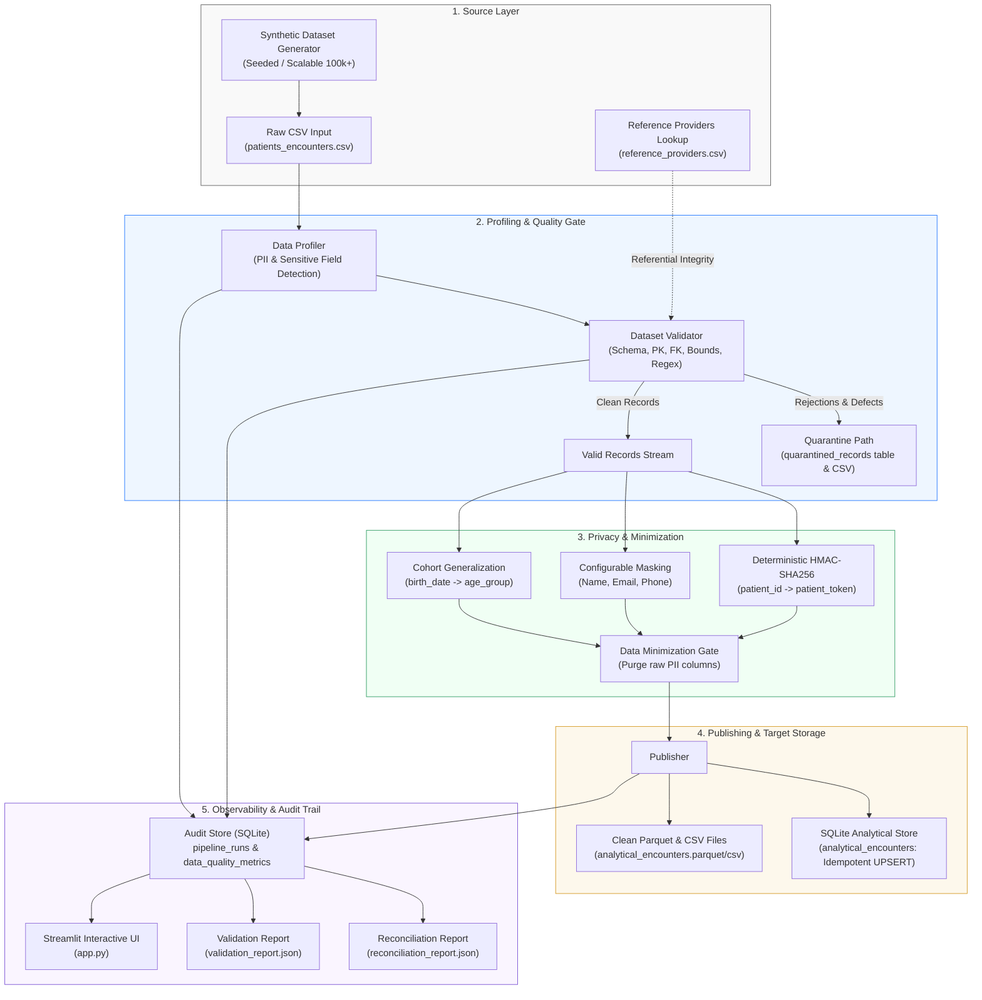

# System Architecture: Privacy-Aware Data Pipeline

This document details the architectural layout, component interactions, data flows, and observability model of the solution.

---

## 1. High-Level Architecture Diagram

---

## 2. Component Breakdown

### 2.1 Synthetic Dataset Generator (`src/generator.py`)
- Employs a deterministic pseudorandom number generator (`np.random.default_rng(seed)`).
- Produces realistic clinical encounters, demographic attributes, and reference registries.
- Supports configurable injection ratios for deliberate defects (missing fields, malformed formats, out-of-bounds metrics) and duplicates to thoroughly test validation gates.
- Highly scalable: generates 100,000+ rows in ~3.5 seconds.

### 2.2 Data Profiler (`src/profiler.py`)
- Scans ingested datasets for structure, null distributions, cardinality ratios, and duplicate rows.
- Automatically identifies sensitive fields using regex pattern matching (Email, Phone, National ID) and semantic keyword classification (`name`, `patient_id`, `birth_date`).
- Recommends actionable privacy transformations (`TOKENIZE`, `MASK`, `GENERALIZE`, `DROP`).

### 2.3 Dataset Validator & Quarantine Router (`src/validator.py`)
- Acts as the primary data quality firewall.
- Validates schema conformity, primary key uniqueness and non-nullness, required business fields, format compliance, referential integrity against provider registries, and domain range limits (`treatment_cost >= 0`).
- Routes anomalies directly to the **Quarantine Path** with explicit error codes (`MISSING_REQUIRED_FIELD`, `DUPLICATE_PRIMARY_KEY`, `INVALID_DOMAIN_VALUE`, `REFERENTIAL_INTEGRITY_VIOLATION`, `MALFORMED_EMAIL`, `MALFORMED_TIMESTAMP`) and serializes the complete source record in JSON format for traceability.

### 2.4 Privacy Transformation Engine (`src/privacy.py` & `src/transformer.py`)
- **HMAC-SHA256 Tokenization**: Cryptographically transforms surrogate keys (e.g. `patient_id`) using a pipeline salt. Tokens are deterministic—enabling cohort linking and longitudinal analytical joins across different files and batches without disclosing the raw patient ID.
- **Configurable Masking**:
  - Name masking: Replaces internal characters with asterisks while keeping initials (`R*** K****`).
  - Email masking: Preserves email domain for categorical segmentation while masking user prefix (`ra***@domain.com`).
  - Phone masking: Preserves the last 4 digits (`***-***-1234`).
- **Age Generalization**: Maps birth dates into demographic cohorts (`<18`, `18-29`, `30-49`, `50-64`, `65+`), mitigating quasi-identifier re-identification risks.
- **Data Minimization Gate**: Completely purges raw sensitive fields (`patient_id`, `full_name`, `email`, `phone_number`, `national_id`, `birth_date`) from the analytical dataset.

### 2.5 Audit Trail & Target Publishing (`src/audit.py` & `src/publisher.py`)
- **Storage Layer**: SQLite with Write-Ahead Logging (`WAL`) mode for robust, concurrent, ACID-compliant local transactions.
- **Analytical Tables**: Target `analytical_encounters` table utilizes an **idempotent UPSERT strategy** (`INSERT OR REPLACE INTO ...`), guaranteeing that rerun batches do not duplicate target rows.
- **File Publishing**: Emits both run-specific and canonical `.parquet` (columnar analytical storage) and `.csv` files.
- **Reconciliation Engine**: Calculates zero-discrepancy balance sheets (`Input == Valid + Quarantined`), validates financial aggregate parity (sum of treatment cost in source vs target), and outputs JSON audit artifacts.
